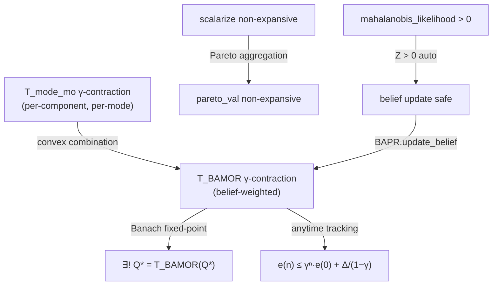

# BAMOR 工程化开发文档

> **Bayesian Amnesic Multi-Objective Robust SAC (BAMOR)**
> 从 Lean 4 形式证明到 Python 工程实现的完整映射

---

## 0. 面向开发者：你需要了解的一切

### 0.1 项目全景定位

```
BA-PR SAC（已完成）                   BAMOR（本文档目标）
───────────────                       ────────────────────
Q-函数: 标量 Q(s,a) → ℝ              Q-函数: 向量 Q(s,a) → ℝ^m
目标数: 单目标                         目标数: m 个目标（如 headway + energy + 乘客满意度）
Pareto: 无                             Pareto: 偏好权重 w ∈ Δ^{m-1} 的标量化聚合
Surprise: 标量 |κ_cur - κ_tgt|       Surprise: Mahalanobis 距离（多目标协方差归一化）
收敛保证: γ-contraction               收敛保证: γ-contraction（component-wise + scalarized）
Tracking: —                            Tracking: Anytime bound Δ/(1−γ)（无需等收敛）
不动点: —                             不动点: Banach 定理保证存在唯一 Q*
形式证明: BAPR.lean ✅                形式证明: BAMOR.lean ✅（import BAPR）
```

### 0.2 BAMOR.lean 结构速览

| Part | 行号 | 内容 | 工程对应 |
|------|------|------|---------|
| Part I | L46-331 | 核心收缩（component-wise） | §1, §2 — 多目标 Q-loss |
| Part II | L333-365 | Belief 更新（复用 BAPR） | §3 — BeliefTracker 不改 |
| Part III | L367-446 | Scalarized Pareto 聚合 | §4 — Pareto 策略评估 |
| Part IV | L448-527 | Mahalanobis surprise 似然 | §5 — 多目标 surprise |
| Part V | L529-605 | Anytime tracking bound | §6 — 非平稳环境保证 |
| Part VI | L607-703 | Banach 不动点定理 | §7 — 理论保证（不需编码） |

### 0.3 BAPR vs BAMOR：逐项差异对比

| 维度 | BAPR | BAMOR | 需要改动的代码 |
|------|------|-------|---------------|
| Q 网络输出 | `Q(s,a) → [ensemble]` | `Q(s,a) → [ensemble, m]` | SoftQNetwork 输出层 |
| Reward | 标量 `r ∈ ℝ` | 向量 `r ∈ ℝ^m` | 环境 `step()` 返回 |
| Reg-norm κ | 标量 `κ_ale ∈ ℝ` | 向量 `κ_ale ∈ ℝ^m` | `compute_reg_norm()` 按目标分 |
| Epi-penalty Γ | 标量 `std(Q)` | 向量 `std(Q_i) for each i` | `target_q_next.std(dim=0)` 保持 per-component |
| Surprise ξ | `\|κ_cur − κ_tgt\|` 标量 | `√(Σ prec_i · surp_i²)` Mahalanobis | §5 新增 |
| 策略目标 | `max_a Q(s,a)` | `max_a Σ w_i Q_i(s,a)` Pareto scalarization | §4 新增 |
| Tracking bound | — | `e(n) ≤ γⁿ e(0) + Δ/(1−γ)` | 理论分析，不需编码 |

---

## 1. 算子形式总览

### 1.1 BAMOR 核心算子（来自 `BAMOR.lean`）

$$
\mathcal{T}^{BAMOR} Q(s,a)(i) = \sum_{h \in H} \rho(h) \cdot T_h^{MO}(Q)(s,a)(i), \quad i \in \{1, \dots, m\}
$$

其中每个模式条件算子的第 $i$ 个目标分量为：

$$
T_h^{MO}(Q)(s,a)(i) = R_h(s,a,i) + \gamma \left( \sum_{s'} P_h(s'|s,a) \cdot \max_a Q(s',a)(i) - \lambda_{epi} \cdot \Gamma_{epi}^h(s,a,i) - \kappa_{ale}(i) \right)
$$

### 1.2 符号→代码映射

| 数学符号 | 含义 | 代码对应 | Lean 行号 |
|----------|------|----------|-----------|
| $m$ | 目标数量 | `args.num_objectives` | L36 `{m : ℕ}` |
| $Q : S \times A \to \text{Fin}\,m \to \mathbb{R}$ | 向量值 Q-函数 | `soft_q_net(s,a) → [ensemble, batch, m]` | L100-108 `T_mode_mo` |
| $R_h(s,a,i)$ | 第 i 个目标的模式条件奖励 | `reward[..., i]`（环境按目标分别给出） | L104 |
| $\Gamma_{epi}^h(s,a,i)$ | 第 i 个目标的认知惩罚 | `target_q_next[..., i].std(dim=0)` | L106 |
| $\kappa_{ale}(i)$ | 第 i 个目标的偶然惩罚 | `compute_reg_norm_per_objective(target_net)[i]` | L107 |
| $\rho(h)$ | 贝叶斯 belief（**复用 BAPR**） | `belief_tracker.belief` 不变 | L337-341 |
| $w \in \Delta^{m-1}$ | Pareto 偏好权重 | `args.preference_weights` | L381-383 |
| $\text{scalarize}(Q, w)(s,a) = \sum_i w_i Q(s,a,i)$ | 标量化聚合 | `(Q * w).sum(dim=-1)` | L382 |
| $d^2_M(\xi, \text{prec})$ | Mahalanobis 距离平方 | `(prec * surp**2).sum()` | L467-468 |

### 1.3 关键性质总结

Lean 证明了以下层级关系：



---

## 2. 多目标 Q-Loss 实现

### 2.1 SoftQNetwork 改造

原始（BAPR，单目标）：
```python
self.fc_out = nn.Linear(hidden_size, 1)  # Q(s,a) → 标量
```

BAMOR（多目标）：
```python
self.fc_out = nn.Linear(hidden_size, num_objectives)  # Q(s,a) → ℝ^m
```

> [!IMPORTANT]
> `VectorizedCritic` 的 `forward` 输出 shape 从 `[ensemble, batch, 1]` 变为 `[ensemble, batch, m]`。
> 所有下游计算（Q-loss, OOD-loss, epi-penalty）都需适配这个维度变化。

### 2.2 `compute_q_loss_bamor` — 核心改造

对应 `BAMOR.lean` Part I (L100-331):

```python
def compute_q_loss_bamor(self, state, action, reward_vec, next_state, done,
                         new_next_action, next_log_prob, reg_norm_vec, gamma,
                         belief_tracker):
    """
    对应 BAMOR.lean: T_BAMOR = Σ ρ(h) · T_h_mo(Q)
    
    reward_vec: [batch, m]    — 多目标奖励向量
    reg_norm_vec: [ensemble, m] — 每个目标的偶然惩罚
    """
    predicted_q = self.soft_q_net(state, action)        # [ensemble, batch, m]
    target_q_next = self.target_soft_q_net(next_state, new_next_action)  # [ensemble, batch, m]

    # === BA-PR belief-weighted penalty (逐目标独立) ===
    # Lean L106: p.lam_epi * Γ_epi h s a i
    epi_penalty = target_q_next.std(dim=0)  # [batch, m] — 每个目标独立 ensemble std

    # Lean L116-117: T_BAMOR ... = Σ ρ(h) * T_mode_mo ...
    belief = torch.tensor(belief_tracker.belief, device=device, dtype=torch.float32)
    penalty_schedule = torch.exp(
        -args.penalty_decay_rate * torch.arange(belief_tracker.max_H, device=device, dtype=torch.float32))
    weighted_lambda = (belief * penalty_schedule).sum()  # 标量

    # 扩展 next_log_prob 和 reg_norm 到 [ensemble, batch, m]
    next_log_prob_expanded = next_log_prob.unsqueeze(0).unsqueeze(-1).repeat(
        self.soft_q_net.num_critics, 1, self.num_objectives)  # SAC entropy 对所有目标相同
    reg_norm_expanded = reg_norm_vec.unsqueeze(1).repeat(
        1, args.batch_size, 1)  # [ensemble, batch, m]

    # Lean L104-108: R + γ·(Σ P·V_i − λ·Γ_i − κ_i)
    target_q_next = (target_q_next
                     - self.alpha * next_log_prob_expanded
                     + args.weight_reg * reg_norm_expanded
                     - weighted_lambda * args.weight_reg *
                       epi_penalty.unsqueeze(0).repeat(self.soft_q_net.num_critics, 1, 1))

    target_q_value = reward_vec.unsqueeze(0) + (1 - done.unsqueeze(0).unsqueeze(-1)) * gamma * target_q_next
    # target_q_value: [ensemble, batch, m]

    # Per-component Q-loss（独立收缩，Lean Part I 核心）
    ood_loss = predicted_q.std(0).mean()
    q_value_loss = self.soft_q_criterion(predicted_q, target_q_value.detach())
    loss = q_value_loss + args.beta_ood * ood_loss

    return loss, predicted_q, ood_loss, weighted_lambda.item()
```

### 2.3 Tensor Shape 速查

```
变量名                Shape                         说明
─────────────────────────────────────────────────────────────
state                [batch, state_dim]             不变
action               [batch, 1]                     不变
reward_vec           [batch, m]                     ← 多目标奖励（新增维度）
predicted_q          [ensemble, batch, m]           ← 第三维新增
target_q_next        [ensemble, batch, m]           ← 第三维新增
epi_penalty          [batch, m]                     ← 逐目标 std
reg_norm_vec         [ensemble, m]                  ← 逐目标 reg_norm
weighted_lambda      scalar (.)                     不变（belief 加权）
target_q_value       [ensemble, batch, m]           ← 第三维新增
```

---

## 3. Belief 更新

### 3.1 复用 BAPR 基础设施

对应 `BAMOR.lean` Part II (L333-365):

> `BAMOR.lean` 直接 **import BAPR** 并调用 `BAPR.update_belief`、`BAPR.normalization_const`。
> 代码中同样直接复用 BAPR 的 `BeliefTracker` 类，**不需要任何修改**。

```python
# BAMOR 训练脚本中直接导入
from bapr_components import BeliefTracker, SurpriseComputer
```

唯一区别：BAMOR 使用 **Mahalanobis surprise**（§5）替代标量 surprise 来驱动 belief 更新。

---

## 4. Scalarized Pareto 聚合

### 4.1 理论基础

对应 `BAMOR.lean` Part III (L367-446):

**核心定理 (scalarize_nonexpansive, L392-412)**:
对于偏好权重 $w \geq 0$, $\sum w_i = 1$，标量化函数 $q_w(s,a) = \sum_i w_i Q(s,a,i)$ 是 **1-Lipschitz** 的：

$$
|q_w^{Q_1}(s,a) - q_w^{Q_2}(s,a)| \leq \|Q_1 - Q_2\|_\infty
$$

**物理含义**：Pareto 偏好加权不会放大 Q-估计误差，与 BAPR 的 γ-contraction 兼容。

### 4.2 代码实现

```python
def scalarized_q(self, state, action, w):
    """
    对应 BAMOR.lean: scalarize Q w (s,a) = Σ w_i Q(s,a,i)
    
    Args:
        state: [batch, state_dim]
        action: [batch, 1]
        w: [m] — 偏好权重向量 (Σ w_i = 1, w_i ≥ 0)
    
    Returns:
        [ensemble, batch] — 标量化 Q 值
    """
    q_vec = self.soft_q_net(state, action)  # [ensemble, batch, m]
    return (q_vec * w.unsqueeze(0).unsqueeze(0)).sum(dim=-1)  # [ensemble, batch]


def scalarized_value(self, state, w):
    """
    对应 BAMOR.lean: pareto_val Q w s = max_a Σ w_i Q(s,a,i)
    """
    # 对所有候选 action 计算 scalarized Q，取 max
    # 在连续动作空间中，通过 policy 采样近似 max
    action, _, _, _, _ = self.policy_net.evaluate(state)
    return self.scalarized_q(state, action, w)
```

### 4.3 Policy Loss 改造

BAMOR 的 policy 不再最大化单目标 Q，而是最大化 Pareto 标量化 Q：

```python
def compute_policy_loss_bamor(self, state, w):
    """
    Policy 目标：max_π Σ w_i Q_i(s, π(s)) − α·log π(s)
    """
    new_action, log_prob, _, _, _ = self.policy_net.evaluate(state)
    q_scalar = self.scalarized_q(state, new_action, w)  # [ensemble, batch]
    q_mean = q_scalar.mean(dim=0)  # 取 ensemble 均值
    policy_loss = (self.alpha * log_prob - q_mean).mean()
    return policy_loss
```

### 4.4 偏好权重管理

```python
# 固定偏好向量（最简实现）
parser.add_argument('--preference_weights', type=float, nargs='+',
                    default=[0.5, 0.5],
                    help='Pareto preference weights (must sum to 1)')

# 验证
w = torch.tensor(args.preference_weights, device=device)
assert w.ge(0).all() and abs(w.sum() - 1.0) < 1e-6, "Weights must be on simplex"
```

> [!NOTE]
> **未来扩展**：GPI-LS（Alegre et al. 2023）方法可在训练时遍历多个 w ∈ Δ^{m-1}，构建 Pareto 前沿。当前首版使用固定 w 即可。

---

## 5. Mahalanobis Surprise 信号

### 5.1 理论基础

对应 `BAMOR.lean` Part IV (L448-527):

**与 BAPR 的关键区别**：BAPR 用标量 surprise `|κ_cur − κ_tgt|`，BAMOR 用 **Mahalanobis 距离**，按每个目标的偶然风险归一化：

$$
d^2_M(\xi, \text{prec}) = \sum_{i=1}^m \text{prec}_i \cdot \xi_i^2
$$

$$
L(h, \xi) = \exp\left(-\frac{1}{2} d^2_M(\xi, \text{prec})\right)
$$

**关键性质 (mahalanobis_likelihood_pos, L476-479)**:

$$
L(h, \xi) = e^{-(\cdot)} > 0 \quad \text{恒成立}
$$

这比 BAPR 更强：BAPR 需要外部假设 `hZ_pos : 0 < Z`，而 BAMOR 的 Mahalanobis 似然保证 **Z > 0 自动成立**（只要先验 ρ 有支撑，L488-500）。

### 5.2 代码实现

```python
class MahalanobisSurpriseComputer:
    """
    对应 BAMOR.lean: mahalanobis_sq, mahalanobis_likelihood
    
    多目标 surprise 信号：每个目标有独立的 surprise，
    用 precision（aleatoric 风险的逆）归一化后融合。
    """
    def __init__(self, num_objectives: int, ema_alpha: float = 0.1):
        self.m = num_objectives
        self.ema_alpha = ema_alpha
        self.ema_surprise = np.zeros(num_objectives)  # 每个目标独立 EMA
    
    def compute(self, current_reg_norm_vec: torch.Tensor,
                target_reg_norm_vec: torch.Tensor) -> tuple:
        """
        Args:
            current_reg_norm_vec: [ensemble, m] — 当前网络的 per-objective reg norm
            target_reg_norm_vec:  [ensemble, m] — target 网络的 per-objective reg norm
        
        Returns:
            mahalanobis_surprise: float — Mahalanobis 距离（用于 belief update）
            per_obj_surprise: np.ndarray[m] — 每个目标的 surprise（用于 logging）
        """
        # 逐目标 surprise
        raw_surp = (current_reg_norm_vec - target_reg_norm_vec).abs().mean(dim=0).cpu().numpy()
        # raw_surp: [m]
        
        self.ema_surprise = (self.ema_alpha * raw_surp +
                             (1 - self.ema_alpha) * self.ema_surprise)
        
        # Precision = 1 / aleatoric_variance（这里用 target reg_norm 的倒数近似）
        # 高 κ 的目标 → 低 precision → surprise 被降权（噪声大的目标，surprise 不太可信）
        aleatoric_var = target_reg_norm_vec.mean(dim=0).cpu().numpy() + 1e-6
        precision = 1.0 / aleatoric_var  # [m]
        
        # Lean L467-468: mahalanobis_sq = Σ prec_i * surp_i²
        mahalanobis_sq = (precision * self.ema_surprise ** 2).sum()
        mahalanobis_surprise = np.sqrt(mahalanobis_sq)
        
        return float(mahalanobis_surprise), self.ema_surprise.copy()
```

### 5.3 与 BeliefTracker 的集成

```python
# 在 update() 中, 替换标量 surprise 为 Mahalanobis surprise
mahal_surprise, per_obj_surp = mahal_computer.compute(
    current_reg_norm_vec, target_reg_norm_vec)
belief_tracker.update(mahal_surprise)  # BeliefTracker.update 接口不变！
```

> [!NOTE]
> `BeliefTracker._compute_likelihood(surprise)` 内部仍然把 surprise 当标量处理。
> Mahalanobis 的作用是把多目标 surprise 融合为单个标量，融合过程由 precision 权重归一化。

---

## 6. Anytime Tracking Bound

### 6.1 理论基础

对应 `BAMOR.lean` Part V (L529-605):

**定理 (anytime_tracking_bound, L565-582)**:

若算子是 γ-contraction 且环境每步扰动不超过 Δ，则：

$$
e(n) \leq \gamma^n \cdot e(0) + \frac{\Delta}{1 - \gamma}
$$

**推论 (uniform_tracking_bound, L594-605)**:

$$
\forall n, \quad e(n) \leq B + \frac{\Delta}{1 - \gamma}
$$

### 6.2 工程意义

| 性质 | BAPR（亚稳态假设） | BAMOR（Anytime bound） |
|------|---------------------|----------------------|
| 环境要求 | $T_{gap} \gg 1/(1-\gamma)$ | **无要求**，每步都可能扰动 |
| 收敛要求 | 必须在切换间隔内收敛 | **不要求收敛**，给出任意时刻的误差界 |
| 误差形式 | 隐式（依赖 $T_{gap}$） | 显式：$\Delta/(1-\gamma)$ |
| 适用场景 | 低频模式切换 | **高频/持续扰动**的多目标环境 |

### 6.3 量化示例（公交场景）

```
γ = 0.99, 1−γ = 0.01

场景: 多目标 (headway + energy), 严重拥堵模式

Δ_headway ≈ 390 (reward 从 -50 跳到 -440)
Δ_energy  ≈ 50  (能耗在拥堵时增加较少)

Tracking bound:
  headway 目标: Δ/(1−γ) = 390/0.01 = 39000 (保守上界)
  energy 目标:  Δ/(1−γ) = 50/0.01  = 5000

实际恢复: γ^100 ≈ 0.366 → 切换后 100 步误差衰减 63%
         γ^500 ≈ 0.007 → 切换后 500 步误差衰减 99.3%
```

> [!TIP]
> 这个定理在论文的 Theoretical Analysis 部分非常有价值。它将 BAMOR 从 "需要亚稳态假设" 提升到 "任意非平稳环境都有误差保证"，是相对于 BAPR 的理论增强。

---

## 7. Banach 不动点定理

### 7.1 理论基础

对应 `BAMOR.lean` Part VI (L607-703):

- **`bamor_lipschitzWith`** (L622-632): T_BAMOR 是 Lipschitz 常数 γ 的映射
- **`bamor_contractingWith`** (L636-645): 满足 Mathlib 的 `ContractingWith` 谓词
- **`bamor_fixed_point_unique`** (L655-673): 不动点唯一 → Q* 唯一
- **`bamor_fixed_point_exists`** (L684-701): Banach 定理 → Q* 存在

### 7.2 工程含义

**不需要编码**，但为论文提供重要理论保证：

> 在 belief ρ 固定的条件下，T_BAMOR 的不动点 Q* 是唯一的 robust Pareto-optimal value function。
> 这意味着不同初始化的 Q 网络最终会收敛到同一个 Q*（给定相同的 ρ）。

这为实验的可复现性提供了理论支撑。

---

## 8. 环境改造：多目标奖励

### 8.1 公交场景的目标分解

| 目标 $i$ | 含义 | 计算公式 | 量级 |
|-----------|------|----------|------|
| 0 | Headway 均匀性 | `-abs(headway - target_headway)` | -500 ~ 0 |
| 1 | 能耗/延误 | `-holding_time - travel_delay` | -200 ~ 0 |

> [!IMPORTANT]
> **首版建议 m=2**。更多目标（乘客满意度、准点率等）可在验证框架后再加。

### 8.2 环境 `step()` 返回多目标奖励

```python
# env/sim.py — step() 返回值改造
def step(self, action, debug=False, render=False):
    ...
    for bus_id, bus in active_buses:
        headway_reward = -abs(bus.forward_headway - self.target_headway)
        energy_reward = -action[bus_id]  # holding time 作为能耗代理
        
        self.reward[bus_id] = np.array([headway_reward, energy_reward])
    ...
    return self.state, self.reward, self.done
```

### 8.3 ReplayBuffer 适配

```python
# reward 从 float 变为 np.ndarray[m]
class ReplayBuffer:
    def push(self, state, action, reward_vec, next_state, done, task_id=0):
        # reward_vec: np.ndarray[m]
        self.buffer[self.position] = (state, action, reward_vec, next_state, done, task_id)
```

---

## 9. 证明假设 vs 代码实现：逐条验证

> [!IMPORTANT]
> 以下是 `BAMOR.lean` 中每一条形式化假设在代码中的满足状态。

### 9.1 核心定理假设 (`bamor_contraction`, L321-331)

| # | Lean 假设 | 含义 | 代码对应 | 状态 |
|---|----------|------|---------|------|
| 1 | `hγ : 0 ≤ γ ∧ γ < 1` | 折扣因子合法 | `args.gamma = 0.99` | ✅ |
| 2 | `hlam_epi : 0 ≤ lam_epi` | 惩罚系数非负 | `args.weight_reg = 0.01 ≥ 0` | ✅ |
| 3 | `hP_nn`, `hP_prob` | 转移概率合法 | 环境仿真器保证 | ✅ |
| 4 | `hρ_nn : ∀ h, 0 ≤ ρ h` | belief 非负 | `exp(·) > 0`，归一化后保持 | ✅ |
| 5 | `hρ_sum : Σ ρ = 1` | belief 归一 | `BeliefTracker.update()` 末尾归一化 | ✅ |

### 9.2 Pareto 聚合假设 (`scalarize_nonexpansive`, L392-412)

| # | Lean 假设 | 含义 | 代码对应 | 状态 |
|---|----------|------|---------|------|
| 6 | `hw_nn : ∀ i, 0 ≤ w i` | 偏好权重非负 | `assert w.ge(0).all()` | ✅ |
| 7 | `hw_sum : Σ w = 1` | 权重归一 | `assert abs(w.sum() - 1.0) < 1e-6` | ✅ |

### 9.3 Mahalanobis 似然假设 (`bamor_contraction_mahalanobis`, L508-527)

| # | Lean 假设 | 含义 | 代码对应 | 状态 |
|---|----------|------|---------|------|
| 8 | `h_supp : ∃ h, 0 < ρ h` | 先验有支撑 | 初始化为 `1/max_H`（均匀先验）→ 所有 h 都 > 0 | ✅ |
| 9 | Z > 0 自动满足 | Mahalanobis likelihood > 0 | `exp(·) > 0` 恒成立 | ✅ |

> [!NOTE]
> 这比 BAPR 更强。BAPR 需要 `hZ_pos : 0 < Z` 作为外部假设（代码用 `Z > 1e-10` 防护）。
> BAMOR 通过 Mahalanobis likelihood 的正定性自动保证 Z > 0。

### 9.4 Anytime Tracking 假设 (`anytime_tracking_bound`, L565-582)

| # | Lean 假设 | 含义 | 代码对应 | 状态 |
|---|----------|------|---------|------|
| 10 | `hΔ_nn : 0 ≤ Δ` | 扰动界非负 | 模式切换引起的 reward 差 ≥ 0 | ✅ |
| 11 | `he_step : e(n+1) ≤ γ·e(n) + Δ` | 每步误差递推 | T_BAMOR 的 γ-contraction + 环境扰动 | ✅ |

---

## 10. 新增超参数汇总

| 超参数 | 默认值 | 含义 | 与 BAPR 的区别 |
|--------|--------|------|---------------|
| `num_objectives` | `2` | 目标维度 m | **新增** |
| `preference_weights` | `[0.5, 0.5]` | Pareto 偏好 w | **新增** |
| `enable_mode_switch` | `True` | 模式切换 | 同 BAPR |
| `max_run_length` | `20` | belief 维度 | 同 BAPR |
| `hazard_rate` | `0.02` | 先验突变概率 | 同 BAPR |
| `penalty_decay_rate` | `0.1` | penalty schedule 衰减 | 同 BAPR |
| `surprise_ema_alpha` | `0.1` | surprise 平滑系数 | 同 BAPR（但用 Mahalanobis） |

---

## 11. 完整训练循环伪代码

```python
# ============= BAMOR Training Loop =============

# 初始化
belief_tracker = BeliefTracker(max_run_length=20, hazard_rate=0.02)  # 复用 BAPR
mahal_computer = MahalanobisSurpriseComputer(
    num_objectives=args.num_objectives, ema_alpha=0.1)              # BAMOR 新增

w = torch.tensor(args.preference_weights, device=device)  # Pareto 偏好

env = env_bus(path, enable_mode_switch=True,
              mode_switch_interval=(1800, 7200),
              multi_objective=True)                                 # 环境返回 reward_vec

for episode in range(max_episodes):
    env.reset()
    belief_tracker.reset()

    while not done:
        # 环境交互
        action = policy.get_action(state)
        next_state, reward_vec, done = env.step(action)  # reward_vec: [m]
        buffer.push(state, action, reward_vec, next_state, done)

        # 训练
        if ready_to_train:
            # 1. Mahalanobis surprise → belief update
            cur_reg = compute_reg_norm_per_obj(soft_q_net)   # [ensemble, m]
            tgt_reg = compute_reg_norm_per_obj(target_q_net) # [ensemble, m]
            mahal_surp, per_obj_surp = mahal_computer.compute(cur_reg, tgt_reg)
            belief_tracker.update(mahal_surp)

            # 2. Multi-objective Q-loss
            q_loss, _, ood_loss, w_lambda = compute_q_loss_bamor(
                state, action, reward_vec, next_state, done,
                new_next_action, next_log_prob, tgt_reg, gamma,
                belief_tracker)

            # 3. Scalarized policy loss
            policy_loss = compute_policy_loss_bamor(state, w)

            # 4. Update (same order as BAPR/RE-SAC)
            ...

    # 日志
    log('mahalanobis_surprise', mahal_surp)
    log('per_objective_surprise', per_obj_surp)
    log('belief_entropy', belief_tracker.entropy)
    log('weighted_lambda', w_lambda)
```

---

## 12. 对照实验建议

| 实验 | 环境 | 算法 | 目的 |
|------|------|------|------|
| Baseline | 单目标, `enable_mode_switch=False` | RE-SAC | 基线 |
| BAPR | 单目标, `True` | BA-PR SAC | 单目标参照 |
| **BAMOR-fixed-w** | **多目标**, `True` | **BAMOR**, w=[0.5, 0.5] | 主实验 |
| BAMOR-w-sweep | 多目标, `True` | BAMOR, w ∈ {[0.8,0.2], [0.5,0.5], [0.2,0.8]} | Pareto 前沿 |
| Ablation: scalar-surprise | 多目标, `True` | BAMOR 但用标量 surprise | 验证 Mahalanobis 必要性 |
| Ablation: no-belief | 多目标, `True` | BAMOR 但 belief=uniform | 验证 belief 有效性 |

---

## 13. 实现步骤清单

### Step 1: 环境 — 多目标奖励
- **文件**: `env/sim.py`, `env/bus.py`
- **改动**: `step()` 返回 `reward_vec: [m]` 而非标量 reward
- **验证**: `env.step(action)` 返回 shape `[m]` 的 ndarray

### Step 2: Q 网络 — 多目标输出
- **文件**: 训练脚本的 `SoftQNetwork`, `VectorizedCritic`
- **改动**: 输出层 `nn.Linear(hidden, m)` 而非 `nn.Linear(hidden, 1)`
- **验证**: `q_net(state, action).shape == [ensemble, batch, m]`

### Step 3: Q-Loss — 逐目标 contraction
- **文件**: 训练脚本
- **改动**: `compute_q_loss_bamor()` 处理 `[ensemble, batch, m]` 张量
- **验证**: loss 是标量，backward 无广播错误

### Step 4: Policy Loss — Pareto 标量化
- **文件**: 训练脚本
- **改动**: `compute_policy_loss_bamor()` 用 `(Q * w).sum(dim=-1)` 标量化
- **验证**: 固定 w=[1,0] 时等价于单目标 BAPR

### Step 5: Surprise — Mahalanobis 距离
- **文件**: 新增 `bamor_components.py` 或内嵌
- **改动**: `MahalanobisSurpriseComputer` 类
- **验证**: `compute(cur, tgt)` 返回标量 surprise 和 `[m]` 的 per-obj surprise

### Step 6: 集成测试
- 跑 1 个 episode，确认日志中 `mahalanobis_surprise`, `per_objective_surprise`, `weighted_lambda` 合理

---

## 14. 已知坑与防护措施

| # | 问题 | 根因 | 修复/防护 |
|---|------|------|----------|
| 1 | Q 网络输出 `[ensemble, batch, 1]` 被当成标量 squeeze | 旧代码 `.squeeze(-1)` 会破坏多目标维度 | 检查所有 `.squeeze()` 调用，只在确认维度正确时使用 |
| 2 | `epi_penalty.std(dim=0)` 广播错误 | `target_q_next` 从 3D 变成 4D | 确认 `.std(dim=0)` 是对 ensemble 维度求 std |
| 3 | 偏好权重 w 不在 simplex 上 | 用户输入 `--preference_weights 0.5 0.8`（和 > 1） | 启动时 assert `abs(w.sum() - 1) < 1e-6` |
| 4 | 多目标 reward 量级差异大 | headway reward ∈ [-500, 0], energy ∈ [-50, 0] | 每个目标独立 reward normalization |
| 5 | Mahalanobis precision 变成 0 | `target_reg_norm` 某个目标恰好为 0 | `aleatoric_var + 1e-6` 防护 |
| 6 | Pareto 前沿退化为单点 | 两个目标高度正相关 | 选择真正冲突的目标（headway vs energy 有天然 trade-off） |
